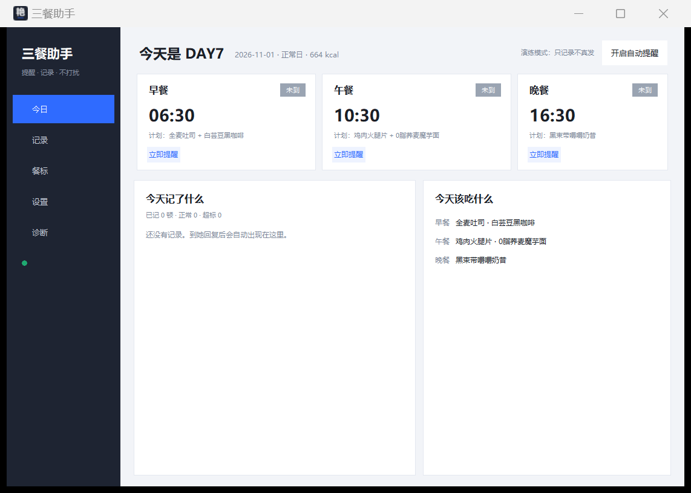

# 三餐助手

一个跑在 Windows 上的「三餐提醒 + 记账」小工具：到点自动在微信里提醒她报备三餐，
自动读取她的回复（文字或照片），按提前设定的 7 天菜单判定是否超标，记账并轻提醒。
全程不需要有人看着屏幕。

> 界面截图：

## 功能

- **定时提醒**：一天三餐，时间可改，改完立即生效
- **自动读取回复**：截图微信聊天区 → 定位最后一条消息 → OCR 或本地视觉模型识别
- **会话校验**：读之前核对聊天标题，不是她就不读；发送前也会校验，防止发错人
- **严格判定**：计划内不超量=合规；超量=超标；计划外=超标；「没吃」=未进食；看不懂=未识别
- **轻提醒**：超标只回一句人话，不报热量、不报份数
- **7 天菜单**：按天轮转，可增删改，支持「DAY1 起始日」
- **台账**：每顿一条记录，保留 60 天，自动清理
- **周报**：每周日 20:00 自动发到文件传输助手
- **桌面应用**：单文件 exe，托盘常驻，开机自启

## 工作原理

微信 4.x 没有可用的本地接口，所以这里不走数据库解密，而是：

1. 用 PrintWindow 截图（窗口被其他程序遮挡也能截到）
2. 按文字像素分行分块，定位最后一条消息，按左右位置判断是谁发的
3. 裁剪后交给 OCR 或视觉模型读出文字
4. 判定 → 记账 → 用 UI 自动化回一句话（提前台约 2 秒，会先检测你是否在打字）

## 环境要求

- Windows 10 / 11
- 微信 4.x（PC 版，保持登录）
- Python 3.10+（仅源码运行需要；打包版不需要）

## 快速开始

```bash
pip install -r requirements.txt
python launcher.py
```

打包成单文件 exe：

```bash
pyinstaller --onefile --windowed --name "三餐助手" --icon assets/icon.ico \
  --add-data "assets;assets" --add-data "config.json;." --add-data "standards.json;." \
  --hidden-import pystray._win32 launcher.py
```

## 配置

第一次运行会在 `%APPDATA%\三餐助手\` 生成 `config.json`、`standards.json` 和 `meals.db`。

- **她的微信备注**：必须和微信聊天窗口顶部显示的一致
- **推演模式**：默认开启，只记录不真发；确认无误后到设置里关掉
- **视觉识别**：可选。填 OpenAI 兼容接口即可（火山方舟 / 本地 Ollama 都行）。
  本地示例：接口地址 `http://127.0.0.1:11434/v1`，模型 `qwen2.5vl:7b`，Key 留空
- **菜单**：`standards.json` 里是 7 天三餐，每项带别名，改完保存即生效

## 隐私

- 聊天内容、照片、台账只存在本机，不上传
- 用云端视觉模型时才会把**裁剪后的那一条消息图片**发出去；不放心就用本地模型
- 仓库里不含任何个人数据

## 已知限制

- 微信窗口必须存在（最小化会自动还原，读完再缩回去），屏幕会闪一下
- 图片消息只能靠视觉模型描述，不接模型时记「未识别」
- 微信大版本更新可能改变界面布局，需要重新校准（设置页有菜单偏移参数）
- 读取延迟约 15 秒（本地 7B 模型）

## 免责声明

微信没有开放个人号接口，本工具的发送依赖桌面 UI 自动化。使用前请自行评估账号风险，
建议先开启「演练模式」验证，并只用于你本人知情的场景。

## 许可证

MIT
